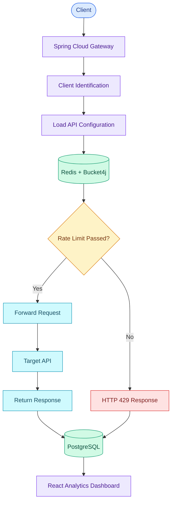
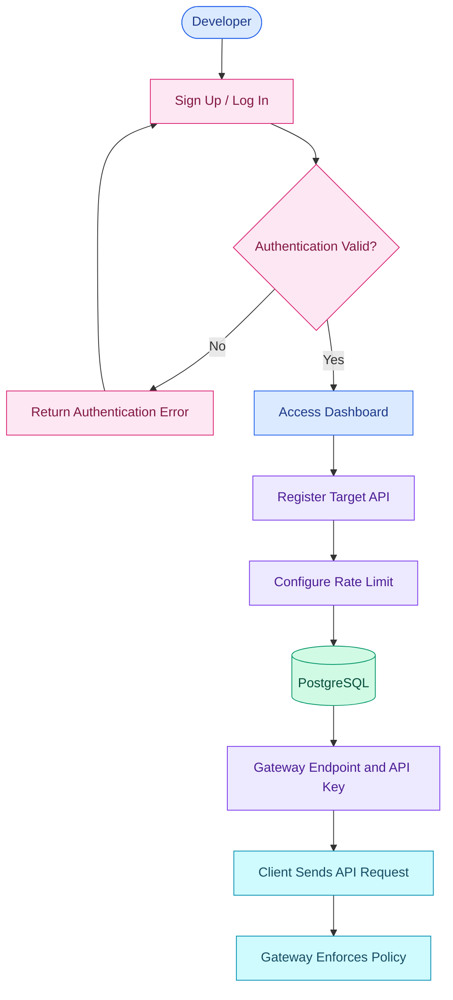
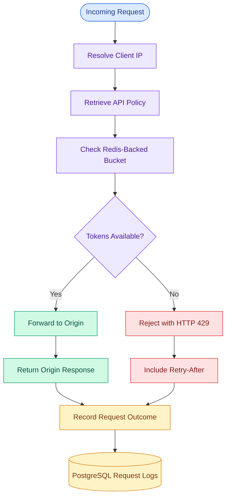
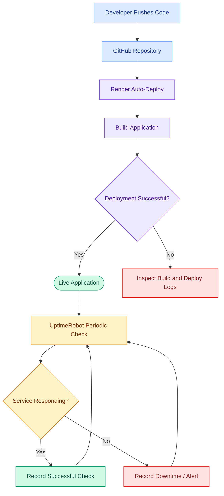

# API Gateway — Self-Service Rate-Limiting Layer for Web APIs

A lightweight, self-service API Gateway that protects existing APIs through distributed rate limiting, authentication, request logging, and traffic analytics — without requiring modifications to the target API.

**Live Website:** https://api-gateway-yp6s.onrender.com/

---

## Overview

Uncontrolled API traffic can cause resource exhaustion, excessive infrastructure costs, unfair resource usage, and service degradation.

This project provides a reverse proxy that allows developers to register APIs, configure request limits, and expose their services through protected gateway endpoints.

The gateway evaluates incoming requests against configured rate-limit policies, forwards permitted requests to their target APIs, and returns **HTTP 429 — Too Many Requests** when the configured limit is exceeded.

## Features

- **Authentication**
  - User registration and login
  - JWT-based authentication
- **Distributed Rate Limiting**
  - Token Bucket algorithm
  - Sliding Window-style fixed-interval limiting
  - Configurable request limits
  - HTTP 429 responses and `Retry-After` support
  - Redis-backed shared rate-limit state
- **Reverse Proxy**
  - Forward requests to registered target APIs
  - Relay origin responses to clients
  - Readable, client-defined gateway paths
- **Client Identification**
  - Real client IP extraction using Cloudflare's `CF-Connecting-IP` header when explicitly enabled
  - Separate rate-limit budgets for different clients
- **API Management**
  - API registration and configuration
  - PostgreSQL-backed API information
- **Request Logging**
  - Client identity, timestamps, and request outcomes
  - Persistent request records
- **Analytics Dashboard**
  - Allowed and blocked request statistics
  - Traffic trends and per-API breakdowns
  - Request log filtering and pagination
- **Reliability**
  - Fail-open behavior when Redis is unavailable
  - Automated deployment through Render's GitHub integration
  - UptimeRobot availability monitoring

## Architecture



The gateway uses Spring Cloud Gateway for request routing, Bucket4j and Redis for distributed rate limiting, PostgreSQL for persistent application data, and React for the analytics interface.

## How It Works

1. A developer creates an account and authenticates.
2. The developer registers a target API.
3. The application provides a gateway endpoint and API key.
4. The developer configures the API's rate-limit policy.
5. A client sends a request through the gateway.
6. The gateway identifies the client and resolves the relevant API configuration.
7. Redis-backed Bucket4j evaluates the rate-limit policy.
8. If permitted, the gateway forwards the request to the target API.
9. If the limit is exceeded, the gateway returns HTTP 429.
10. Request outcomes are persisted in PostgreSQL.
11. The dashboard presents available traffic and request statistics.

## API Registration and Authentication Workflow



## Gateway Request Flow



## Rate-Limiting Algorithms

### 1. Token Bucket

The Token Bucket algorithm maintains a bucket with a configured capacity and refill policy.

- Each permitted request consumes a token.
- Tokens refill according to the configured policy.
- Requests without available tokens are rejected.
- Redis provides shared state across gateway instances.

```text
Bucket Capacity = 5 requests
Refill Policy   = 5 tokens every 20 seconds

Request
   |
   v
Token Available?
   |
   +-- Yes --> Consume Token --> Forward Request
   |
   +-- No  --> HTTP 429
```

### 2. Sliding Window-Style Limiting

The second supported mode uses interval-based token replenishment through Bucket4j's `refillIntervally` configuration.

This provides fixed-interval replenishment rather than the gradual refill behavior of the Token Bucket configuration.

Both modes can be evaluated against comparable workloads to understand their enforcement behavior.

## Distributed Rate Limiting

A single gateway instance can maintain local request state, but local counters cannot guarantee consistent enforcement across multiple instances.

This project uses Redis-backed Bucket4j buckets to maintain shared state.

### Concurrency Validation

The concurrency test uses Testcontainers to start a dedicated Redis instance and exercises the rate-limiting logic with:

- 200 requests
- 20 concurrent threads
- A configured capacity of 20 requests

The observed result was exactly 20 admitted requests out of 200.

### Multi-Instance Validation

Two gateway instances were tested against the same Redis instance. Requests shared a common rate-limit budget rather than receiving separate independent budgets on each instance.

This validates the shared-state enforcement behavior under the tested configuration.

## Client IP Identification Behind Cloudflare

When the application is deployed behind Cloudflare, the gateway's direct remote address can represent a Cloudflare edge server instead of the original client.

To address this, the gateway supports extracting the client IP from the `CF-Connecting-IP` header.

- The behavior is configurable and disabled by default.
- When enabled behind the intended Cloudflare deployment, the header provides the client IP used for rate-limit key construction.
- Different clients can receive separate rate-limit budgets.
- Logs can record the resolved client IP for diagnosis.

**Security consideration:** Forwarded client-IP headers must only be trusted when the application is protected by a trusted proxy that controls those headers. Enabling this option on a directly accessible deployment can allow clients to spoof their identities.

## Readable Gateway URLs

The gateway supports readable client-defined path names rather than requiring numeric identifiers in the public path.

For example:

```text
Numeric-style path:
/g/4/forecast

Readable path:
/weatherhello/forecast
```

Readable paths make endpoints easier to recognize and share without requiring a separate DNS record for each registered API.

## Fail-Open Behavior

The rate limiter uses a fail-open policy for Redis connectivity failures.

If Redis becomes unavailable, the gateway logs a warning and allows the request through rather than returning an unhandled server error solely because rate-limit state cannot be accessed.

This improves availability but temporarily weakens rate-limit enforcement during Redis outages. The trade-off is intentional and should be considered when deploying the gateway for security-sensitive workloads.

## Technology Stack

| Component | Technology |
|---|---|
| Backend | Spring Boot |
| API Gateway | Spring Cloud Gateway |
| Rate Limiting | Bucket4j |
| Distributed State | Redis |
| Database | PostgreSQL |
| Persistence | Spring Data JPA |
| Authentication | Spring Security and JWT |
| Frontend | React |
| Charts | Recharts |
| Unit Testing | JUnit |
| Integration Testing | Testcontainers |
| API Testing | Postman |
| Version Control | Git and GitHub |
| Deployment | Render |
| Uptime Monitoring | UptimeRobot |

## Deployment and Uptime Monitoring



### Continuous Deployment

Render is configured to deploy automatically when new commits reach the connected GitHub branch.

Typical workflow:

1. Make changes locally or directly on GitHub.
2. Commit and push the changes to the configured branch.
3. Render detects the commit and starts a deployment.
4. Verify that the deployment succeeds and the service becomes live.

GitHub Actions can be used for automated testing and build checks where configured; Render handles the application's deployment in the current hosting setup.

### UptimeRobot

UptimeRobot periodically checks the deployed website to monitor availability.

On Render's free tier, periodic requests can help prevent inactivity-related spin-downs, reducing cold-start delays. However, monitoring does not guarantee uninterrupted uptime, and the application may still experience downtime or deployment interruptions.

## Configuration

Configure sensitive settings through environment variables or the hosting platform's environment configuration.

Typical configuration categories include:

```env
# Database
DATABASE_URL=
DATABASE_USERNAME=
DATABASE_PASSWORD=

# Redis
REDIS_HOST=
REDIS_PORT=
REDIS_PASSWORD=

# Authentication
JWT_SECRET=

# Gateway
GATEWAY_BASE_URL=
```

The exact variable names depend on the application's configuration.

**Never commit passwords, JWT secrets, database credentials, or other sensitive values to the repository.**

## Testing and Evaluation

The project focuses on validating correctness, reliability, and performance.

Testing includes:

- Unit tests for backend components
- Redis-backed rate-limit tests
- Concurrent request validation
- Multi-instance enforcement tests
- Redis failure handling
- API testing using Postman
- Integration testing using Testcontainers

### Performance Targets

| Metric | Target |
|---|---:|
| Rate-limit enforcement accuracy | ±2% |
| p95 added latency | ≤50 ms |
| Request log completeness | ≥99.9% |
| Gateway availability target | ≥99% |

These are project targets, not guarantees of current production performance. Actual results depend on workload, infrastructure, network conditions, and deployment configuration.

## Project Structure

The repository currently organizes the project into a codebase, journals, proposal documents, and GitHub configuration.

```text
API-Gateway-Project/
├── .github/
│   └── workflows/
├── Journals/
├── Project Proposal/
├── codebase/
│   ├── src/
│   │   ├── main/
│   │   │   ├── java/
│   │   │   └── resources/
│   │   │       └── static/
│   │   └── test/
│   ├── Dockerfile
│   ├── pom.xml
│   └── README.md
└── README.md
```

The exact source folders and configuration files may evolve as the implementation progresses.

## Security Considerations

The gateway's security-related design includes:

- JWT-based user authentication
- Registered API configuration
- Controlled target API routing
- Secure handling of application credentials
- Explicit Redis failure behavior
- Configurable trusted-proxy client IP extraction
- Separation of API configuration from rate-limit enforcement

These controls help reduce misuse of the gateway as an unrestricted proxy. Production deployments should also validate target URLs, restrict access to internal network addresses where appropriate, and configure trusted proxies correctly.

## Future Improvements

Potential future enhancements include:

- Expanded rate-limit algorithm comparisons
- More extensive concurrent load testing
- Improved operational metrics and alerting
- Additional dashboard analytics
- More detailed latency and throughput benchmarks
- Stronger production-grade resilience and security controls

## Team

This project was developed as part of the **UCS503P Project** at Thapar Institute of Engineering and Technology.

| Team Member | Student ID |
|---|---|
| Sarthak Jagota | 1024030753 |
| Palak Mahajan | 1024030755 |
| Aayush Kumar Singh | 1024030758 |
| Dushyant Choudhary | 1024030737 |

## Project Proposal

This implementation is based on the project proposal **“API Gateway: A Self-Service Rate-Limiting Layer for Web APIs”**, submitted for UCS503P on August 8, 2026.

## Project Goal

> Build a lightweight, deployable API protection layer that enables developers to enforce fair request budgets in front of existing APIs without modifying the APIs themselves.

The primary engineering focus is correct distributed rate limiting, measurable performance, backend integration, and reliable API protection.
