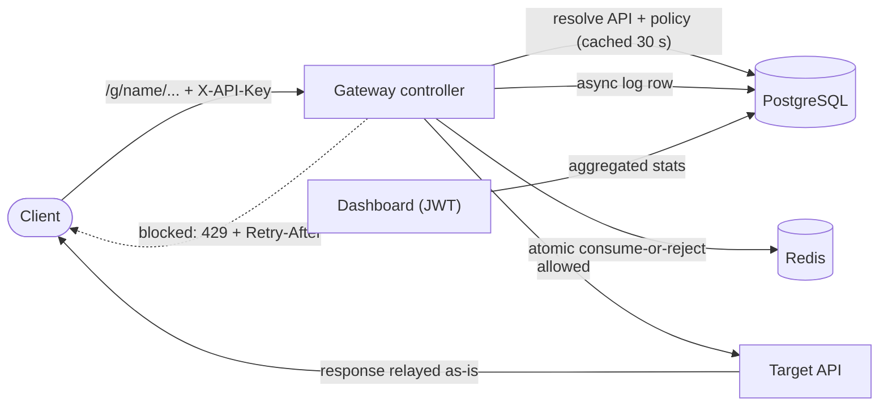

# API Gateway — Self-Service Rate Limiting for Web APIs

A reverse proxy that puts per-client rate limits in front of any existing HTTP API, without changing the API.
A developer registers their API, picks a limit and an algorithm, and gets a gateway URL and an API key.
Clients over their budget get **HTTP 429** with an accurate `Retry-After`.

**Live demo:** https://api-gateway-yp6s.onrender.com/ (free tier, so the first load can take ~30 s)

**Stack:** Java 17 · Spring Boot 4 · Redis · Bucket4j · PostgreSQL · Spring Security + JWT · Docker · GitHub Actions · Testcontainers

---

## Highlights

- **Exact limits across instances.** Every decision is one atomic operation inside Redis, so two gateway instances can never hand out the same slot. In tests, **exactly 20 of 400** concurrent requests got through a limit of 20, using two independent instances, for both algorithms.
- **Two algorithms, chosen per API.** Token bucket (Bucket4j, compare-and-swap on Redis) and a true sliding window (a Redis sorted set updated by a single Lua script).
- **Explicit failure behaviour.** If Redis is down, the gateway either fails open (stays available) or fails closed (keeps protection), as configured. A small circuit breaker stops every request from waiting on a Redis timeout.
- **Logging kept off the request path.** Every request is logged to PostgreSQL asynchronously. **2000 of 2000** concurrent writes landed in tests.
- **Safe to expose.** Only forwards to registered targets, and refuses private, loopback and cloud-metadata addresses (SSRF protection). It re-checks targets whenever a route reloads.
- **Works behind a CDN.** Reads the real client IP from `CF-Connecting-IP` when configured. This is off by default, so local deployments can't be spoofed.
- **Dashboard.** Traffic charts, a filterable request log, a load-test lab and a system health page (Redis status, p50/p95 latency the gateway adds).

## How a request flows



1. `GatewayController` looks up the registered API by its short name in the `RouteCache` and checks the `X-API-Key`.
2. `RateLimiter` asks Redis for a decision, keyed by API and client IP.
3. If allowed, the request is forwarded to the target with the JDK `HttpClient`, and the response (status, headers, body) is relayed back unchanged. Redirects are relayed, not followed.
4. If blocked, the client gets `429` with the real wait time in `Retry-After`.
5. Either way, `RequestLogService` writes the outcome to PostgreSQL on a background thread.

## Rate-limiting algorithms

**Token bucket.** A bucket of capacity *C* refills at *limit / window* tokens per second, and each request takes one token. This allows bursts up to *C* while holding the long-run average. It's implemented with Bucket4j's Redis proxy manager, using compare-and-swap updates. The policy values are part of the Redis key, so editing a policy takes effect immediately.

**Sliding window.** One Lua script, run atomically by Redis:

```lua
redis.call('ZREMRANGEBYSCORE', key, 0, now - window)   -- drop expired entries
if redis.call('ZCARD', key) < limit then                -- room left?
  redis.call('ZADD', key, now, requestId)               -- admit and record
  return -1
end
return oldest + window - now                            -- ms until a slot frees up
```

It uses Redis's own clock (`TIME`), so instances whose clocks disagree still agree on the window. An earlier version used Bucket4j's interval refill, but that's really a *fixed* window: it lets up to 2*N* requests through around a window boundary, which is why it was replaced.

## Results

All results come from `./mvnw verify` against real Redis 7 and PostgreSQL 16 containers.

| What | Target | Result |
|---|---|---|
| Enforcement accuracy: 2 instances, 400 concurrent requests, limit 20 | within ±2% | **20 / 20 admitted** (token bucket and sliding window) |
| Redis down | defined and tested | fail-open allows, fail-closed blocks, breaker answers in < 50 ms |
| Log completeness: 2000 concurrent async writes | ≥ 99.9% | **100%** |
| Log filters (outcome, client, date range, per-API isolation) | correct | 4 / 4 pass |

A local benchmark measured about **26.5 ms** of added latency (the mean over 20 requests, with persistent connections on both sides), against a 50 ms budget. The live System page reports p50 and p95 latency added by the gateway, measured on every request.

## Run it locally

You need Java 17+ and Docker.

```bash
cd codebase
docker compose up --build        # Postgres + Redis + app → http://localhost:8080
```

Or run the app from your IDE or terminal while coding:

```bash
cd codebase
docker compose up -d postgres redis
./mvnw spring-boot:run -Dspring-boot.run.profiles=local    # Windows: .\mvnw.cmd ...
```

Open http://localhost:8080, create an account, register an API, then call it:

```bash
curl http://localhost:8080/g/<short-name>/any/path -H "X-API-Key: <key>"
# over the limit → HTTP 429 + Retry-After
```

Run the tests (Docker must be running):

```bash
cd codebase && ./mvnw verify
```

CI runs the same command on every push.

## Configuration

| Variable | Purpose |
|---|---|
| `DB_URL`, `DB_USERNAME`, `DB_PASSWORD` | PostgreSQL (`jdbc:postgresql://host:5432/db`) |
| `REDIS_URL` | `redis://…` or `rediss://…` for TLS |
| `JWT_SECRET` | **Required.** A random string of 32+ characters. The app refuses to start without it. |
| `FAIL_POLICY` | `open` (default) or `closed`: what to do when Redis is unreachable |
| `CLIENT_IP_HEADER` | Set to `CF-Connecting-IP` only when running behind Cloudflare |

## Design decisions

- **Stateless gateway.** All limiter state lives in Redis, so you can add or remove instances freely.
- **Fail-open by default.** A Redis outage shouldn't take every protected API offline. Set `FAIL_POLICY=closed` where protection matters more than availability. It's an environment setting, not a dashboard toggle, because it affects every API on the gateway.
- **Route cache (30 s).** Avoids a database lookup on every proxied request. Dashboard edits evict the cache immediately on that instance.
- **Owner isolation.** Every management and dashboard endpoint only returns the caller's own APIs. Other users' APIs return 404, not 403, so their IDs aren't revealed.
- **Database-side aggregation.** The dashboard gets counts and percentiles from SQL, never raw log rows.

## Project structure

```text
codebase/
├── src/main/java/com/gateway/api_gateway/
│   ├── gateway/      GatewayController, RateLimiter, RouteCache
│   ├── controller/   auth, API registration, dashboard, system endpoints
│   ├── service/      registration, auth, async logging, SSRF validation
│   ├── security/     JWT filter and utilities
│   ├── entity/ repository/ dto/ config/
├── src/main/resources/static/index.html    dashboard (single page, no build step)
├── src/test/         Testcontainers integration tests
├── Dockerfile, docker-compose.yml
Project Proposal/  Project Report/  Journals/   course documents
```

## Known limitations

- Budgets are per client IP. Per-API-key budgets aren't supported yet.
- Log writes are fire-and-forget (`@Async`), so a crash can lose the last few rows.
- The DNS check runs at registration and route reload, not at the moment of each connection.

## Team

Built as a team project for **UCS503P** at Thapar Institute of Engineering and Technology.

| Name | Roll no. |
|---|---|
| Sarthak Jagota | 1024030753 |
| Palak Mahajan | 1024030755 |
| Aayush Kumar Singh | 1024030758 |
| Dushyant Choudhary | 1024030737 |

## License

[MIT](LICENSE)
